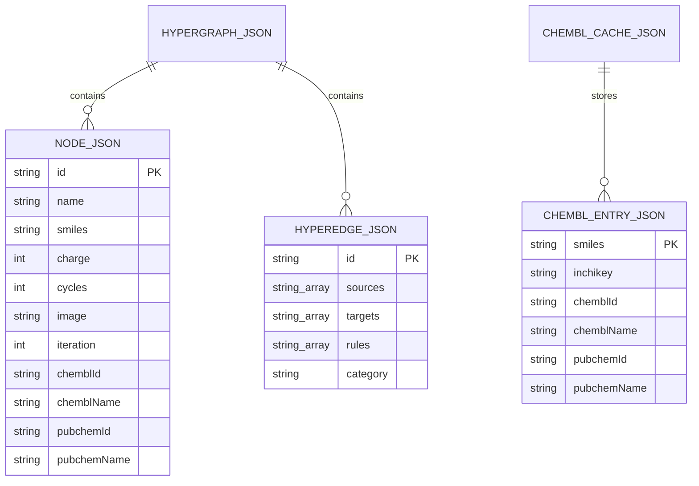
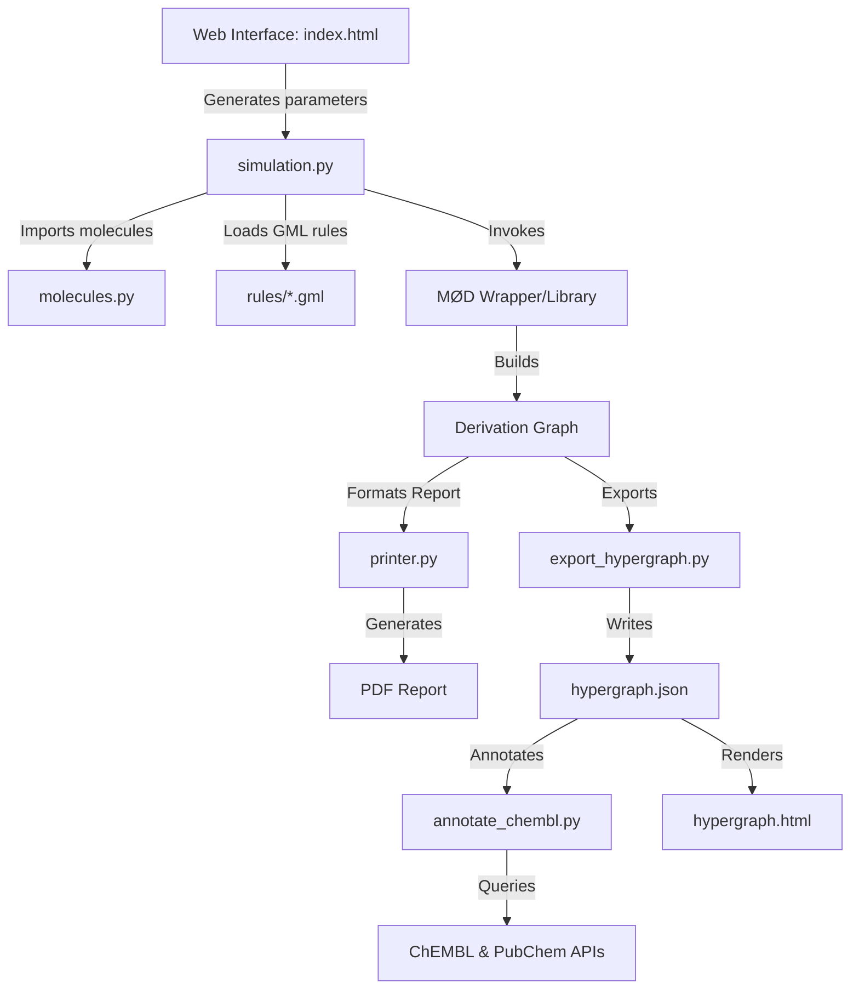

# 2PathTerpenes

*Also available in:* 🇧🇷 *[Português (Brasil)](README.PTBR.md)*

## Project Summary
**2PathTerpenes** is a bioinformatics and chemical modeling tool based on graph grammar to reconstruct and explore metabolic networks of terpene biosynthesis (C10 monoterpenes and C15 sesquiterpenes). The project utilizes the **MedØlDatschgerl (MØD)** simulator and the Double Pushout (DPO) formalism to generate synthesis pathways for complex molecules (such as $\beta$-caryophyllene, $\alpha$-humulene, and $\beta$-farnesene) starting from linear acyclic precursors like Farnesyl Diphosphate (FPP). The simulation results can be exported as structural PDF reports or as an interactive HTML/JavaScript hypergraph viewer, optionally annotated with compound identifiers from the ChEMBL database.

## Feature List
*   **Molecular Topological Definition**: Modeling of chemical precursors and carbocations using SMILES linear representations and DFS in graphs.
*   **GML Reaction Rule Grammar**: Application of realistic reaction mechanisms (cyclizations, Wagner-Meerwein rearrangements, hydride shifts, water addition and elimination).
*   **Automatic Chemical Network Generation**: Combinatorial exploration and search for reachability pathways solved by Integer Linear Programming (ILP).
*   **Visual Plotting and Export**: PDF report generation showing the structural chemical derivation graph.
*   **Cyclization Constraint Analysis**: Proposals for thermodynamic and 3D geometric filters (ring strain) on chemical routes.

---

# Architecture

## Database (or other storage format)
This project uses JSON-based files for persistent storage and metadata cache, along with a GML rules dataset.

### Database Diagram


### Data Dictionary

#### Nodes Table (inside `hypergraph.json` -> `nodes`)
| Field | Type | Description |
|---|---|---|
| `id` | String | Unique vertex identifier (e.g., `v0`, `v1`). |
| `name` | String | Name of the chemical compound (e.g., `GPP`, `limonene`). |
| `smiles` | String | SMILES representation of the molecule. |
| `charge` | Integer | Net charge of the carbocation/neutral molecule. |
| `cycles` | Integer | Number of rings/cycles in the molecule. |
| `image` | String | Relative path to the depiction SVG file. |
| `iteration` | Integer | Shortest path steps from the initial precursors (0-indexed). |
| `chemblId` | String | (Optional) ChEMBL compound identifier. |
| `chemblName` | String | (Optional) Common name fetched from ChEMBL database. |
| `pubchemId` | String | (Optional) PubChem compound identifier (CID). |
| `pubchemName` | String | (Optional) Common name fetched from PubChem database. |

#### Hyperedges Table (inside `hypergraph.json` -> `hyperedges`)
| Field | Type | Description |
|---|---|---|
| `id` | String | Unique hyperedge/reaction identifier (e.g., `e0`, `e1`). |
| `sources` | Array of Strings | Reactant/educt node IDs. |
| `targets` | Array of Strings | Product node IDs. |
| `rules` | Array of Strings | Names of the reaction rules applied. |
| `category` | String | Reaction category (`mono`, `sesqui`, or `common`). |

#### ChEMBL Cache Table (`chembl_cache.json`)
| Field | Type | Description |
|---|---|---|
| `smiles` | String | SMILES representation of the molecule (Primary Key). |
| `inchikey` | String | Calculated InChIKey (hash) of the SMILES structure. |
| `chemblId` | String | ChEMBL compound identifier (or null if not matched). |
| `chemblName` | String | Common name of the compound in ChEMBL (or null if not matched). |
| `pubchemId` | String | PubChem compound identifier (or null if not matched). |
| `pubchemName` | String | Common name of the compound in PubChem (or null if not matched). |

## Components
The simulation workflow is divided into components for graph specification, DPO grammar application, derivation graph generation, and database persistence.

### Component Diagram


### Web Interface
The web interface (https://waldeyr.github.io/2PathTerpenes) provides a responsive dashboard for selecting reaction rules and defining simulation parameters.

### Technologies and their Versions

| Technology | Version | Main Function |
|---|---|---|
| MedØlDatschgerl (MØD) | v1.0.0+ | Chemical graph transformation kernel (DPO) and ILP solver. |
| Python | v3.8+ | Simulation automation scripts (`molecules.py`, `simulation.py`, `printer.py`). |
| Open Babel | v3.0+ | 3D conformation generation and energy calculation of carbocations. |
| Docker | v19.x+ | Full Linux environment packaging for agnostic execution of MØD. |

---

## Features

### Requirements

| Feature | Form Field | Database Field | Applied Rules |
|---|---|---|---|
| **Molecular Definition** | N/A (Script file) | `Compound.smiles`, `Compound.modName` | SMILES or DFS syntax to initialize the simulation reagents multiset. |
| **Chemical Network Generation** | N/A (Script file) | `Rule.modName`, `Compound.id` | Repetitive application of DPO graph rewriting rules (`addSubset >> repeat`). |
| **PDF Generation** | N/A (Final report) | N/A | Rendering of intermediates with collapsed hydrogens and coloring (red for rings, blue for charges). |
| **Scenario Saving** | N/A (Load script) | `Scenario.scenarioID`, `Scenario.ncbiAccession`, `Scenario.pubmedAccession` | Relational mapping of molecules and physical reactions with in vitro assays described in the literature. |

---

## Cyclization Constraint Analysis in Simulation Rules
During the generation of sesquiterpene synthesis pathways, electrophilic cyclization reactions occur with high molecular reactivity. Since traditional MØD operates only at the topological level of discrete graphs, cyclizations that are impossible to occur in actual 3D space due to high conformational strain could be simulated.

We have identified **four potential architectural improvements** to implement cyclization constraints in the simulations:
1. **Conformational Energy Filter (via Open Babel)**: With MØD v1.0.0+, Open Babel calculates 3D coordinates and estimates the free energy of each carbocation using the MMFF94 force field (`Graph.energy`). A validation script in Python can be implemented to discard cyclization intermediates where the conformational energy delta relative to the precursor is excessive (inviable ring strain).
2. **Constraints in the GML Rules Context**: Addition of rigid paths and preventing topology in the `context` of the GML rule. This prevents the rule from being applied if the molecule already contains rigid adjacent ring systems that physically prevent chain folding.
3. **Heuristics with Custom Derivation Strategy (DGStrat in Python)**: Use a derivation strategy written in Python to intercept cycle creation and block reactions that generate incompatible strained rings (e.g., complex bridged rings of 3 or 4 carbons in inappropriate positions).
4. **Hyperflow and Linear Programming with Costs**: In MØD v1.0, the Integer Linear Programming (ILP) solver can assign costs and capacities based on thermodynamic constraints in the overall network flow, minimizing energetically unfavorable pathways.

---

## Installation and Usage

### Organization of Rules and Resource Files
*   **GML Rules (`rules/`)**: All official GML reaction rules are maintained and updated directly in the `rules/` directory.
*   **Resource Images (`docs/img/`)**: Only images actively used or dynamically referenced (like rule previews) by `docs/index.html` are kept in version control. Temporary or redundant image files are cleaned up prior to committing.

### Generating GML Rule Previews

To generate the SVG preview images for the chemical reaction rules shown in the web interface:

1. **Run the generator inside Docker** (this compiles the GML rules and outputs `.pdf` files in `out/`):
   ```bash
   docker run --rm --user "$(id -u):$(id -g)" --volume "$(pwd):/home/shared" --workdir /home/shared 2path-terpenes-mod:latest -f /home/shared/generate_rules_svg.py
   ```

2. **Convert the generated PDFs to SVGs** (running the loop inside the MØD container in one go):
   ```bash
   docker run --rm --user "$(id -u):$(id -g)" --entrypoint /bin/bash --volume "$(pwd):/home/shared" --workdir /home/shared 2path-terpenes-mod:latest -c "for f in out/*_{L,K,R}.pdf; do mod_post --mode pdfToSvg \${f%.pdf} \${f%.pdf}; done"
   ```

3. **Copy generated SVGs to the assets folder**:
   ```bash
   python organize_svgs.py
   ```
   This helper script copies `_L.svg`, `_K.svg`, and `_R.svg` components from `out/` directly to `docs/img/` preserving their original names.

### Running Simulations with Docker (Recommended)

#### How to test on your machine:

1. **Rebuild the Docker image**:
   ```bash
   docker build -t 2path-terpenes-mod:latest .
   ```
   *(Note: The Docker image installs the LaTeX compiler with support for Latin Modern fonts through the Debian package `lmodern`, fixing potential compilation issues for the summary report `summary.pdf`. To support minimal LaTeX environments, we also include a fallback mock `lmodern.sty` in the workspace, so the compilation automatically falls back to default LaTeX fonts if `lmodern` is missing.)*

2. **Run the main project simulation**:
   ```bash
   docker run --rm --user "$(id -u):$(id -g)" --volume "$(pwd):/home/shared" --workdir /home/shared 2path-terpenes-mod:latest -f /home/shared/molecules.py -f /home/shared/simulation.py -f /home/shared/printer.py
   ```

### Interactive Hypergraph Viewer (HTML/JS)

In addition to the LaTeX/PDF report, the derivation graph can be exported as a standalone, interactive, browser-based "metro map" of the chemical hypergraph: molecules are stations and reactions (which may have several educts/products) are the connections between lines, color-coded by rule category (Mono/Sesqui/Common).

#### Quick way (recommended): `run-pipeline.sh`

Use this command to generate the viewer. It is the only entry point that runs
the simulation, hypergraph export, PDF→SVG conversion, validations, and HTML
assembly. Manual Docker commands that include only `printer.py` generate PDFs,
but **do not** generate the HTML viewer.

```bash
bash run-pipeline.sh
```

Each execution is isolated in `runs/<id>/`, so artifacts from separate runs are
never mixed. The script prints the resulting
`runs/<id>/report/hypergraph.html`, which can be opened directly. Monitor a
long run with:

```bash
tail -f runs/<id>/logs/pipeline.log
cat runs/<id>/status.json
cat runs/<id>/progress.json
```

To run the expanded simulation (all rules, seven iterations), use:

```bash
bash run-pipeline.sh --full
```

Before a long run, test the complete pipeline with a single iteration:

```bash
bash run-pipeline.sh --smoke
```

The pipeline preserves a log for every stage in `runs/<id>/logs/` and a combined
log in `logs/pipeline.log`. `status.json` records the PID, Git commit, local
changes, timestamps, stage and exit code. Command failures, logging errors and
helper failures mark the run as `failed`. `SIGHUP`, `SIGINT` and `SIGTERM` also
record the interruption and terminate the stage's processes. `SIGKILL` and a
machine shutdown cannot be handled this way.

Before publication, the validator compares the JSON embedded in the HTML with
`out/hypergraph.json`, checks image paths, parses every copied molecule SVG,
and rejects missing or empty files, including CSS, JavaScript and the logo.
The report is built in `report.tmp/` and renamed to `report/` only after
validation. Failed runs preserve their artifacts for inspection.

Python loops publish real counters and use `tqdm` when available. During MØD's
native processing and PDF compilation, a separate process emits a heartbeat
every 30 seconds to the log and `progress.json`. A heartbeat reports an active
stage, not an estimated kernel percentage. The file separates the stage state
(`stageStatus`) from the last Python phase state (`status`) and reports elapsed
time (`stageElapsedSeconds`).

#### Long runs and configuration

To keep a run alive after disconnecting SSH, use `nohup` with a known run ID:

```bash
nohup bash run-pipeline.sh --full --run-id full-run > full-run-console.log 2>&1 < /dev/null &
tail -f full-run-console.log
```

The script can also be executed directly as `./run-pipeline.sh`. The run ID
must be new; an existing run is neither overwritten nor automatically resumed.

To use another disk or change the monitoring interval:

```bash
RUNS_DIR=/path/to/runs HEARTBEAT_SECONDS=15 bash run-pipeline.sh --full --run-id full-run
```

`RUNS_DIR` accepts absolute paths or paths relative to the directory from which
the command is invoked. The actual run directory is mounted as `/run` inside
the container. `IMAGE` selects an already-built Docker image. Preflight checks
the image, write access and free space on the destination disk: at least 6 GiB
for standard/full runs and 1 GiB for `--smoke`. Set `MIN_FREE_GIB` to adjust this
threshold; it does not estimate or guarantee space for an entire run. The host
requires Python 3.9+ and Docker on Linux or macOS.

The monolithic derivation-graph PDF is separate from the interactive HTML
viewer: it asks Graphviz to lay out the entire network. By default, the
pipeline omits that PDF above 5,000 vertices or 10,000 edges because the layout
does not scale reliably; the interactive export and molecule depictions remain
enabled. Adjust the limits with `PDF_REPORT_MAX_VERTICES` and
`PDF_REPORT_MAX_EDGES`. Use `FORCE_PDF_REPORT=1` only for a deliberately sized
run that must generate the complete PDF.

For large networks the viewer retains the entire embedded dataset, with global
search and pages of 100 molecules. A view draws at most 500 molecules, 500
reactions and 2,000 connections; every displayed reaction includes all its
participants. Instead of shrinking hundreds of rows into sub-pixel marks, a
large page opens in a readable pan/zoom window. Total and visible counts are
shown. Pathways use the complete network; detail lists show up to 100
reactions. These display limits do not truncate simulation/export results.

PDF→SVG conversion publishes each image only after its XML passes validation.
Partial images left by interrupted conversions are regenerated; valid existing
images can be reused. Fontconfig uses a writable container cache, including
when Docker runs with the host UID.

For large runs, the pipeline starts MØD with `--nopost` because MØD clears
`out/` on startup. The `compile-depictions` stage then creates
`out/disableInvokeMake`, runs `mod_post` to generate the per-depiction rules,
and requests only the molecule PDF targets through
`compile_molecule_pdfs.py`. This prevents the single `summary/all.tex` recipe
from exceeding GNU make's 65,535-line limit; the monolithic summary PDF is
built only when the configured graph limits allow it.

#### Regression tests

```bash
python3 -m unittest discover -s tests -v
node --test tests/test_viewer.cjs
```

The tests check invalid packages, signals, logging failures, heartbeats and
custom run directories using a Docker substitute. They do not run MØD; use
`--smoke` to check integration with the installed Docker image.

Reproducible scale test (synthetic data and SVGs; does not run the chemical
simulation or measure depiction rendering for real molecular structures):

```bash
python3 tests/stress_pipeline.py --output-dir /tmp/2path-stress-new
# Optional, with Playwright and Chrome installed:
node tests/browser_scale.cjs /tmp/2path-stress-new/report/hypergraph.html
```

This validates/packages 50,000 molecules, 125,000 reactions and 50,000 SVGs on
disk. By default each SVG is about 10 KiB, matching the production-scale
average; use `--svg-bytes` to change it. The directory must be new; stage
timings, source SVG bytes and final HTML size are saved in `metrics.json`.
Unit tests also cover a reverse-ordered 50,000-molecule chain, reactant semantics
and preventing large graphs from invoking `DGPrinter`. On ARM Macs the current
MØD package requires building with
`docker build --platform linux/amd64 -t 2path-terpenes-mod:latest .`.

#### Manual execution from the project root

The following steps use the root-level `out/` and `report/` directories without
the isolation and monitoring provided by `run-pipeline.sh`.

1. **Export the hypergraph as JSON** (run alongside the existing simulation scripts):
   ```bash
   docker run --rm --user "$(id -u):$(id -g)" --volume "$(pwd):/home/shared" --workdir /home/shared 2path-terpenes-mod:latest -f /home/shared/molecules.py -f /home/shared/simulation.py -f /home/shared/export_hypergraph.py -f /home/shared/printer.py
   ```
   This writes `out/hypergraph.json` and renders one PDF depiction per molecule.

2. **Convert only the PDFs referenced by `out/hypergraph.json` to SVG**:
   ```bash
   docker run --rm --user "$(id -u):$(id -g)" --entrypoint python --volume "$(pwd):/home/shared" --workdir /home/shared 2path-terpenes-mod:latest /home/shared/convert_hypergraph_svgs.py
   ```

3. **(Optional) Annotate molecules with database identifiers**:
   ```bash
   python annotate_chembl.py
   ```
   For each molecule with a `smiles` field, this computes its InChIKey (via the `obabel` CLI) and looks up an exact match in the [ChEMBL REST API](https://www.ebi.ac.uk/chembl/api/data/molecule). If no match is found, it falls back to looking up the InChIKey in the **PubChem PUG-REST API**. The script adds matching `chemblId`/`chemblName` or `pubchemId`/`pubchemName` fields to `out/hypergraph.json`. Results are cached in `out/chembl_cache.json` so repeated runs do not query the external APIs for previously seen structures. Matched molecules show their respective database links and common names in the viewer's details panel and become searchable.

4. **Build the standalone report**:
   ```bash
   python organize_hypergraph_assets.py
   ```
   This assembles `report/hypergraph.html` together with its CSS/JS and the molecule depiction SVGs, with the hypergraph data embedded inline so the page works offline via `file://`.
   If `report/` already exists, choose a new destination with `REPORT_DIR=report-new python3 organize_hypergraph_assets.py`; the builder preserves previous packages.

5. **Open `report/hypergraph.html`** directly in a browser. The whole `report/` folder is self-contained and can be zipped and shared.

The viewer supports pan/zoom, search by molecule name, filtering by reaction category, and clicking a molecule or reaction to see its details (SMILES, charge, rings, applied rule(s)).
